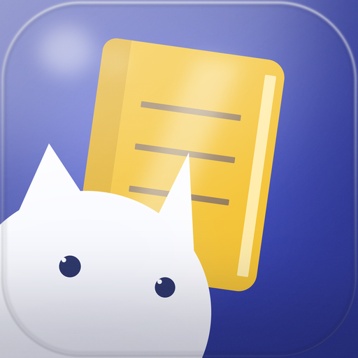
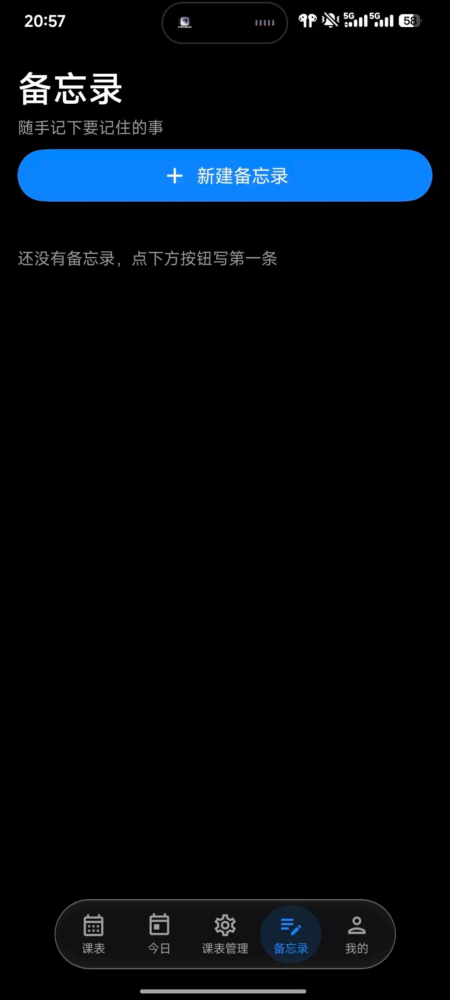

# Easy课表 · 大学课程表与待办

> 课表 / 课程表 / 大学课程表 / 高校课表 / 教务系统一键导入 / 待办清单 / 桌面小组件 / Android 课表 App / Timetable &amp; Class Schedule

<p align="center">
  
</p>

<p align="center">
  <b>给中国大学生用的课表 + 待办应用</b><br>
  388 所高校教务系统一键导入 · 备忘录与待办 · 桌面小组件 · iOS 风格界面
</p>

<p align="center">
  
  
  
  
  
</p>

---

## 这是什么

Easy课表是一个**完全离线**的 Android 课表应用：直接从学校的教务系统把课表抓进来，配上今日视图、桌面小组件、备忘录与待办提醒。所有数据存在手机本地（Room / SQLite），不注册、不上传、不联网也能用。

它面向的是最普通的大学场景：

- 每学期开头手动录入几十门课，一节课填五个字段——这件事本身就该被自动化；
- 教务系统各校千差万别（正方 / 青果 / 强智 / 金智 / URP / 各类定制），没有哪个 App 能一网打尽；
- 课表和"今天要交的作业、要开的会"天然是一件事，分成两个 App 反而更麻烦。

所以这个 App 做了三件事：**把课表导进来**、**把今天讲清楚**、**把要做的事记下来并叫醒你**。

## 下载 / 安装

- **最新安装包**：[Releases · v0.13.0-launch](https://github.com/chapwpzip/EasyKeBiao/releases/tag/v0.13.0-launch)
  （`EasyKeBiao-v0.13.0-launch.apk`，25.59 MB，arm64-v8a / armeabi-v7a / x86 / x86_64 四 ABI 整包，`versionCode 26`）
- 支持 **Android 8.0（API 26）及以上**，直接安装，无需注册账号
- 覆盖安装即可升级，数据库会按内置迁移逐步升级，**课表不会丢**

> 当前发布的是 **debug 签名** 测试包（包名 `com.imsx3d.classy.debug`），可与正式版共存；
> 正式签名版本需自备 keystore 自行构建（见下方「构建」）。

## 界面

| 课表 | 今日 | 备忘录 / 待办 |
| --- | --- | --- |
| 待补充 | 待补充 |  |

| 我的 | 桌面小组件 | 应用图标（自适应） |
| --- | --- | --- |
| 待补充 | 待补充 |  |

> 截图会在 `docs/screenshots/` 里按 `01-schedule.jpg`、`02-memo.jpg`…… 命名，当前先放了一张实机图，其余正在补。

## 功能

### 一、课表

- **多课表**：一个学期可以有多张课表（不同年级/不同方案），随时切换，互不干扰。
- **周次与节次**：自定义学期起止、总周数、当前周；节次时间表可自建（`节次模板`），支持上午/下午/晚上不同节次与自定义时间。
- **课程**：名称、教师、地点、星期、起止节、周次（含单双周）、颜色、备注、别名（同一门课在不同课表里显示不同名字）。
- **网格与列表**：主界面是周网格，另提供课程列表、学期总览、课程详情页。
- **节假日与调休**：标记某天不上课，周次推进自动跳过。
- **冲突提示**：同一时段叠加时给出可视提示，便于调整。

### 二、导入（核心能力）

教务导入是本项目投入最多的地方：**内置 388 所高校的教务入口**，覆盖 35 种协议实现。

| 导入方式 | 说明 |
| --- | --- |
| 教务导课 | 选学校 → 内置 WebView 打开该校教务 → 登录后自动抓取课表并解析 |
| 分享码 | 把课表编码成一段文本，别人粘贴即可导入（跨设备迁移也用它） |
| 一键导课 | 从文件、图片里识别课表 |
| AI 网页识别 | 打开任意网页课表，交给识别流程抽取课程 |
| 演示 | 一键生成示例课表，用于体验或截图 |
| 手动新建 | 传统方式，支持从网格点空格直接新建 |

教务适配覆盖面（节选，`app/src/main/assets/schools.json`）：

- 正方教务（`zf_new` / `zf`，125 + 13 所）、青果（`qz` 等，67 所）、超星（43 所）、金智（`wisedu`，27 所）
- 强智、URP / URP New、EAMS 5、IEAS 2.1、各类学校定制协议（`hnust`、`neu`、`ustc`、`scu`、`pku`、`zju`…）
- 研究生系统（`xju_post` 等）单独标记状态

列表支持按拼音首字母/全拼检索与分组，未适配学校可提交"申请适配"。

### 三、今日

当天课程时间线 + 当前节次高亮 + 下一节课倒计时，加上当天的待办。锁屏之外，这是最常打开的一屏。

### 四、备忘录与待办

底栏「备忘录」里是两段式结构：**待办 / 备忘**，切换即时。

**待办**（对标轻量任务清单，而不是项目管理）

- 分组：已逾期 / 今天 / 之后 / 无日期，空分组自动隐藏；已完成折叠成一行。
- 单条待办：标题、备注、截止日、**提醒时刻**、重要标记、置顶、**步骤清单**（子任务，可逐项勾选）。
- 完成交互：点圆圈打勾，行文字加删除线，**屏幕上撒一次礼花**（自绘粒子，无需三方库）。
- 提醒：`AlarmManager` 精确闹钟（无权限时退化为 ±10 分钟窗口），通知里直接「完成 / 稍后 10 分钟」，重启后自动重建闹钟。
- 全部即时写库（Room），无网络依赖。

**备忘**：标题 + 正文 + 置顶，列表按置顶/最近修改排序。

### 五、桌面小组件

- 课表组件：**今日**（小 / 标准 / 宽）、**两日**、**本周视图**、**本周列表**、**课程行**，多档尺寸自动适配。
- **待办组件**：只显示未完成项，**可以直接在桌面上勾选**；勾选时行内打勾、划掉，随后整块卡片撒一次彩带；标题点击回到 App 备忘录栏。
- 组件数据本地直读，App 内任何改动即时推送刷新。

### 六、外观与动效

- 主题：默认（系统蓝）/ 春 / 海 / 桃 / 岩板 / 跟随系统取色；深浅色各自独立调色。
- 排版：iOS 风格字号阶梯、圆角、留白，我的页使用 iOS 式分组卡（inset-grouped）。
- 动效：
  - 页面推入 / 返回用水平位移 + 视差 + 淡入（不是 Material 的缩放）；
  - 底栏 tab 切换交叉淡入；
  - 列表条目与按钮按压缩放反馈；
  - 悬浮胶囊 Dock 与按钮使用**真实高斯模糊玻璃**（Android 13+ 且硬件加速时；否则退化为同色半透明材质）；
  - 组件勾选使用三帧序列（勾→彩带→常态），RemoteViews 不支持连续动画，故用跳帧实现。
- 图标：白猫 + 黄色笔记本，自适应图标（前景绘制在中央 72/108 安全区内），脚本见 `tools/`。

### 七、数据与导出

- 导出 **.ics 日历**、**HTML**、**纯文本（`#easykebiao-v1` 标记格式，可再导入）**、分享码。
- Room 数据库迁移全部手写（3→13），**不使用破坏性迁移**，升级不丢课表。
- 全离线：无账号、无埋点、无网络权限滥用。

## 技术栈

| 层 | 选型 |
| --- | --- |
| 语言 / UI | Kotlin，Jetpack Compose（BOM 2026.09），Material 3 + 自研 Glasense 设计体系（本地模块 `glasense-ui`） |
| 导航 | `navigation-compose` + 类型安全路由（`@Serializable` NavKey），转场自定义 |
| 数据 | Room 2.7（KSP、手写迁移、导出 schema）、DataStore、WorkManager |
| 异步 | Kotlin Coroutines / Flow |
| 网络与解析 | 内置 WebView 抓取 + Jsoup 解析，按学校协议适配 |
| 图片与图形 | Coil、Canvas 自绘（礼花、组件位图）、`kyant0/backdrop` 真模糊玻璃 |
| 组件 | AppWidget（RemoteViews 位图与行列表两套渲染） |
| 测试 | JUnit4 + 契约测试（269 suites / 2366 tests），含数据库迁移、路由完整性、组件 XML 契约、学校数据一致性 |

最低 Android 8.0（API 26），目标 API 37。

## 构建

需要 JDK 21 与 Android SDK（compileSdk 37）。

```bash
# 1. 配置 SDK 路径
echo "sdk.dir=/path/to/android-sdk" > local.properties

# 2. 编译调试包
./gradlew :app:assembleDebug
# 产物：app/build/outputs/apk/debug/app-universal-debug.apk

# 3. 全量单测
./gradlew :app:testDebugUnitTest
```

> 仓库已开启 ABI 拆分（arm64-v8a / armeabi-v7a / x86_64），同时产出 universal 整包。
> release 变体需要自备签名（`keystore.properties`），否则 `verifyReleaseSigning` 会失败。
> 改版本号必须同步 `app/src/main/assets/release-notes.json`，`verifyReleaseNotes` 会校验两者一致。

## 目录结构

```
app/src/main/java/com/imsx3d/classy/
├── data/            # Room 实体/DAO/迁移、解析器、仓库
│   ├── jw/          # 教务适配：协议识别、抓取、解析、学校模型
│   └── parser/      # 课表文本/HTML/ICS 解析
├── ui/
│   ├── nav/         # 类型安全路由、NavHost、转场
│   ├── screen/      # 课表、今日、我的、设置、导入、备忘录/待办
│   ├── component/   # Dock、卡片、动效、礼花、玻璃
│   └── theme/       # 颜色、字体、形状、主题预设
├── widget/          # 桌面小组件（课表 / 待办 / 提醒通知）
└── util/            # 偏好、格式化、导出
glasense-ui/         # 自研设计体系（颜色/排版/形状/组件）
docs/                # 设计文档、截图、品牌资源
tools/               # 构建期辅助脚本（图标生成等）
```

## 相对上游的增量

本项目是基于开源课表 **IMSX3D/Classy** 的二次开发，源码层面的主要增量：

1. **备忘录模块**：`memos` 表（DB 10→11）、列表与编辑页、置顶。
2. **待办模块**：`todos` / `todo_steps` 两张表（DB 11→12）、四段分组、步骤清单、编辑弹窗、完成礼花。
3. **待办提醒**：`reminderAt` 字段（DB 12→13）、精确闹钟调度、通知动作（完成 / 稍后）、开机重排。
4. **待办桌面组件**：可勾选的行列表 RemoteViews、三帧完成动画、彩带贴图、尺寸自适应。
5. **界面重做**：iOS 风格配色与字号、inset-grouped 列表、分组设置页、玻璃 Dock 与玻璃按钮、推入/返回位移转场、按压反馈。
6. **组件库移植**：从 Cresto 移植玻璃外观、倾斜按压、着色器涟漪、带模糊的进出场等 11 个组件文件。
7. **品牌与图标**：应用名、图标、导出格式标记、分享文案全部换成 Easy课表；图标由脚本生成（像素/矢量混合绘制）。
8. **教务扩量**：学校库 350 → 388 所，新增基于**响应正文厂商特征**的协议判型与兜底页对照探测（见 `tools/`）。
9. **设置增强**：启动直达页面（可选落到课表 / 今日 / 课表管理 / 备忘录 / 我的）。

## 参考项目与致谢

这个 App 站在一堆开源项目的肩膀上，逐条列出：

| 项目 / 资源 | 许可证 | 用途 |
| --- | --- | --- |
| [IMSX3D/Classy](https://github.com/IMSX3D/Classy) | GPL-3.0 | **上游基础**：课表数据层、教务适配框架、桌面小组件、导出、设置与大部分页面结构 |
| [NevoDev/Cresto](https://github.com/NevoDev/Cresto) | Apache-2.0 | **UI 组件参考与移植**：玻璃外观（内阴影+高光）、倾斜按压、着色器涟漪、带模糊的进出场、礼花按钮；待办的数据形态与交互也参考了它 |
| Glasense UI（上游附带的本地模块 `glasense-ui`） | 见模块内声明 | 设计体系：颜色、排版、形状、基础组件 |
| [Kyant0/AndroidLiquidGlass](https://github.com/Kyant0/AndroidLiquidGlass)（Maven `io.github.kyant0:backdrop`） | Apache-2.0 | 真实高斯模糊玻璃 / 折射（Dock 与按钮） |
| [Kyant0/Shapes](https://github.com/Kyant0/Shapes)（Maven `io.github.kyant0:shapes`） | Apache-2.0 | 胶囊等形状 |
| [xioajiumi/Chinese_Universities](https://github.com/xioajiumi/Chinese_Universities) | 见仓库声明 | 高校名录（582 所）作为教务入口探测的输入 |
| [pypinyin](https://github.com/mozillazg/python-pinyin) | MIT | 生成学校名的拼音排序键（构建期工具，不随 App 分发） |
| [AndroidX / Jetpack Compose / Room / WorkManager](https://developer.android.com/jetpack) | Apache-2.0 | 应用框架 |
| [jsoup](https://jsoup.org/) | MIT | HTML 解析（教务页面与导入） |
| [Coil](https://coil-kt.github.io/coil/) | Apache-2.0 | 图片加载 |
| [kotlinx.serialization](https://github.com/Kotlin/kotlinx.serialization) | Apache-2.0 | 路由与 JSON |
| [SQLite JDBC](https://github.com/xerial/sqlite-jdbc) | Apache-2.0 | 迁移契约测试（测试期） |

调研过程中看过但**没有直接采用代码**的项目：`dairoot/school-api`（正方系统 SDK 文档）、`baifan97/urp`、`codelumos/xiaomi-aischedule-adapter`（各校适配器仓库）。

另外：界面文案、图标、脚本与文档由本人在 AI 编程助手（DeepSeek）协作下完成；教务入口的探测脚本、判型规则与人工复核结果为本人产出。

## 许可证

本项目沿用上游许可证，采用 **GNU General Public License v3.0**（见 [LICENSE](LICENSE)）。原始版权归 IMSX3D/Classy 及其贡献者所有；本仓库的修改部分同样以 GPL-3.0 发布。

如果你要基于它二次开发并分发，请保留许可证与原作者署名。
